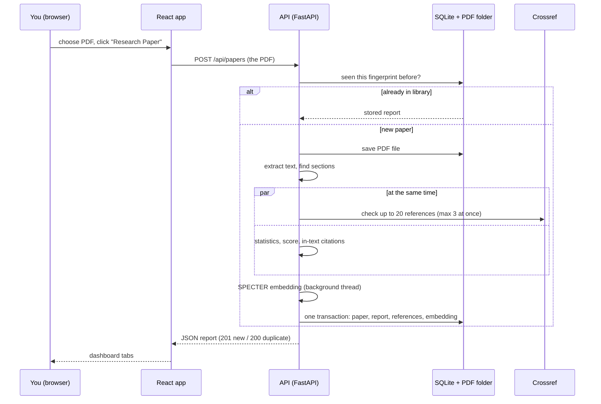
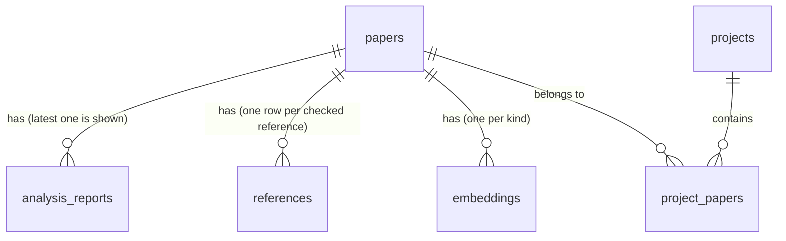

# How AIRA works — an architecture map

*Written 2026-10-26 for someone new to software architecture. Line numbers point at the
code as of this date; timings were measured on the dev machine (WSL2) the same day.*

## The 30-second version

AIRA is three programs talking to each other, plus a few outside services:

```
 ┌──────────────────────────┐   HTTP + JSON    ┌──────────────────────────┐
 │  Browser: React app      │ ───────────────▶ │  API server: FastAPI     │
 │  (frontend/, port 5173)  │ ◀─────────────── │  (app/, port 8000)       │
 └──────────────────────────┘                  └───────────┬──────────────┘
                                                           │
            ┌──────────────────────┬───────────────────────┼──────────────────────┐
            ▼                      ▼                       ▼                      ▼
   SQLite database file      Folder of PDFs        Crossref + OpenAlex     SPECTER AI model
   data/aira.db              data/pdfs/            (internet services)     (runs inside the
   (all results)             (uploaded files)      check refs / find       API server; turns
                                                   related papers          text into numbers)
```

A restaurant analogy:

- The **React app** is the dining room and menu: it shows you things and takes your order.
- The **API** is the waiter: it only accepts orders that are on the menu. Each menu item is
  called an *endpoint* (for example, "POST /api/papers" means "here is a PDF, analyze it").
- The **services** are the kitchen stations, each doing one job (read the PDF, check
  references, find statistics, compute the score).
- The **database** is the pantry and order book: it remembers every paper and result.
- **Crossref** and **OpenAlex** are suppliers the kitchen calls when it needs outside data.

There is also an older Streamlit app (`app_v2.py`, port 8501) that uses the same API. It is
frozen — the React app is the real product.

## Words you'll see

| Word | Plain meaning |
|------|---------------|
| **Frontend / backend** | The part you see in the browser / the part that does the work on a server. |
| **API, endpoint** | The backend's menu of allowed requests. An endpoint is one menu item: a method plus a path, like `GET /api/papers` ("give me the list") or `POST /api/papers` ("take this file"). |
| **JSON** | The text format the frontend and backend use to send data back and forth. |
| **Router** (FastAPI) | A file that groups related endpoints — `app/routers/papers.py` has every `/api/papers` endpoint. Routers check the request and hand the real work to services. |
| **Service** | Plain Python functions that do the work (`app/services/`). They don't know about HTTP. |
| **Schema** (Pydantic) | The exact shape of data going in or out, checked automatically (`app/schemas/models.py`). A bad request gets a clear error instead of crashing. |
| **ORM model** (SQLAlchemy) | A Python class that maps to a database table; one object = one row (`app/db/models.py`). |
| **Migration** (Alembic) | A script that changes the database's structure safely, step by step (`alembic/versions/`). `alembic upgrade head` applies them all. |
| **async / `asyncio.gather`** | Lets the server wait on slow things (like Crossref over the internet) without freezing, and run several waits at once. |
| **Semaphore** | A counter that limits how many requests run at once — AIRA sends at most 3 to Crossref at a time, to be polite. |
| **Cache** | A short-term memory of answers. AIRA remembers each reference check for 24 hours (in memory, so it's lost on restart). |
| **Embedding** | A list of 768 numbers that summarizes a piece of text. Papers on similar topics get similar numbers, so "similar papers" becomes simple math. AIRA uses the SPECTER model for this. |
| **CORS** | A browser safety rule: a web page may only call an API that explicitly allows that page's address. AIRA's API allows `localhost:5173` (the React app) and a couple of other local ports. |
| **React Query** | Frontend library that fetches data from the API, keeps a copy, and knows when to fetch again. |
| **Vite, Tailwind, shadcn/ui** | The frontend's dev server/bundler, its styling system, and its kit of ready-made buttons, tables and dialogs. |
| **Design tokens** | Named colors and sizes (for example "status-verified") defined once and reused everywhere, so the look stays consistent. |

## The parts, and where they live

| Part | Where | Job | Look here when you want to… |
|------|-------|-----|------------------------------|
| Pages | `frontend/src/pages/` | One file per screen: `Home.jsx` (landing + upload), `Library.jsx`, `PaperDetail.jsx`, `ProjectDetail.jsx` | change what a screen shows |
| UI pieces | `frontend/src/components/` | Citation table, statistics panel, score gauge, paper cards; `ui/` is the shadcn kit | change one widget |
| Talking to the API | `frontend/src/api/airaApi.js` | Every HTTP call the frontend makes, in one place | add or change a request |
| Caching layer | `frontend/src/api/queries.js` | React Query hooks; tells the library to refresh after changes | fix stale data on screen |
| Report → screen | `frontend/src/lib/reportTransform.js` | Turns the backend's report into what the dashboard renders | change how results are summarized |
| Server entry | `backend.py` → `app/main.py` | Starts the server, loads SPECTER, sets CORS, plugs in routers | change startup or allowed origins |
| Endpoints | `app/routers/*.py` | health, pdf, analysis, papers, projects — 21 endpoints in total | add or change an endpoint |
| The real work | `app/services/*.py` | `pdf.py` (text), `references.py` (Crossref), `statistics.py`, `integrity.py` (score), `citations.py`, `embeddings.py`, `similarity.py`, `openalex.py`, `ingest.py` (runs the whole pipeline) | change how analysis works |
| Data shapes | `app/schemas/models.py` | Request/response shapes, including `IntegrityReport` | add a field to a response |
| Tables | `app/db/models.py`, `alembic/versions/` | The 6 tables, and the scripts that create/change them | store something new |
| Settings | `app/config.py` + `.env` | Limits, contact email, CORS origins, analyzer version | change a limit or toggle |
| Tests | `tests/` | 89 backend tests; external services are faked | check a change didn't break things |

## Follow one request: uploading a PDF

This is the most important flow in the app. Here's what happens, in order, when you upload
a paper on the home page.

1. **You pick a file and click through.** `FileUploader.jsx` checks it's a PDF under 10 MB.
   "Start Analysis" doesn't upload anything yet (`FileUploader.jsx:59`); it moves you to a
   "what type of content is this?" choice. Clicking **Research Paper** calls
   `handleContentTypeSelected` (`Home.jsx:41`).
2. **The browser sends the file.** `airaApi.ingestPdf` (`airaApi.js:34`) wraps the file in a
   form and sends `POST http://localhost:8000/api/papers`. Meanwhile the screen shows a
   progress animation. It runs on a fixed ~10-second timer and is *not* connected to the real
   progress (A1 of the redesign replaces it).
3. **The API checks the door.** CORS middleware (`app/main.py:32-41`) confirms the request
   comes from an allowed page. The router (`app/routers/papers.py:56-82`) rejects files that
   aren't named `.pdf`, don't start with `%PDF`, or exceed 10 MB, then hands the bytes to the
   ingest service.
4. **Ingest runs the pipeline** (`app/services/ingest.py:61`):
   1. **Fingerprint and dedup** (lines 70-90). It computes the file's SHA-256 hash — a unique
      fingerprint of its bytes. If that fingerprint is already in the database, it returns the
      stored result immediately (HTTP 200, about 10 ms) and stops.
   2. **Save the PDF** to `data/pdfs/<fingerprint>.pdf` (lines 92-95).
   3. **Extract text** with pypdf and find section headings like "Methods" (lines 97-105).
      About 0.3 s for an 11-page paper. A scanned PDF has no text layer, so this yields
      nothing — ingest does not run OCR.
   4. **Run four analyses at once** with `asyncio.gather` (lines 107-132):
      - **References** (`references.py:193`): find the reference list, take the **first 20**
        entries, and check each against Crossref — by DOI if the reference has one, otherwise
        by searching the citation text. Each gets a confidence score and a status: verified
        (≥ 0.75), suspicious (≥ 0.45) or not found. This is the slow step, because it waits on
        Crossref over the internet: at most 3 calls at once, retried on errors, cached 24 h.
      - **Statistics** (`statistics.py:8`): pattern-matching for p-values, sample sizes,
        effect sizes and confidence intervals, plus "red flags" and "good practices".
      - **Score** (`integrity.py:10`): starts at 100 and adds or subtracts points for the
        transparency signals above, then maps the number to a letter grade.
      - **In-text citations** (`citations.py:8`): counts markers like `[12]` and
        `(Smith, 2020)`.
   5. **Build the report** — one `IntegrityReport` object holding all of it (lines 134-158).
   6. **Save everything in one transaction** (lines 160-200): the paper row, the report (as
      JSON, stamped with the analyzer version), one row per checked reference, and the
      SPECTER embedding of the paper's first 1,000 characters. That one is computed in a
      background thread so the server doesn't freeze (`ingest.py:210-226`). "One
      transaction" means all of these rows are written together, or none are.
5. **The answer goes back** as JSON with HTTP 201 ("created").
6. **The screen updates.** `buildAnalysisContent` (`reportTransform.js:88`) reshapes the
   report for the dashboard tabs (Citations, Statistics, Quality, Summary). Home then tells
   React Query the paper list is out of date (`Home.jsx:66`), so the Library refetches next
   time you open it.

**How long it takes (measured 2026-10-26):** about 4–8 s for an 11-page PLOS ONE paper and
about 11 s for the 15-page Transformer paper from arXiv. Nearly all of that is waiting on
Crossref. A repeat upload of the same file takes about 10 ms.



## A second request: opening a paper from the Library

1. `/library` calls `GET /api/papers` (`papers.py:85`). A database query (plus a count for
   paging) lists papers with their latest score and grade. It deliberately never loads the full text, which can be
   megabytes. About 13 ms.
2. Clicking a card opens `/papers/:id`, which fires three requests at once:
   - `GET /api/papers/{id}` — the paper plus its stored report (about 5 ms).
   - `GET /api/papers/{id}/similar` — loads every stored embedding and ranks papers by
     cosine similarity, which is just multiplying and adding numbers
     (`similarity.py:17`). About 6 ms; fine up to roughly 10,000 papers.
   - `GET /api/papers/{id}/related` — looks up the paper's DOI on OpenAlex and returns its
     "related works" list (`openalex.py:67`, cached 24 h, about 0.1–0.6 s). No DOI found in
     the PDF means no related works.

## The database in one picture



- `papers` — one row per unique PDF: fingerprint, title, DOI, file path, full text, sections.
- `analysis_reports` — the full report as JSON, plus the score and grade copied into their own
  columns so lists can show them quickly. Each is stamped with `analyzer_version` (now 1.0.1),
  so you can tell which scoring rules produced it.
- `references` — the checked references, pulled out of the report so they can be queried.
- `projects` + `project_papers` — folders. A paper can be in many projects
  ("many-to-many"); `project_papers` is the link table between them.
- `embeddings` — the 768 SPECTER numbers per paper, stored as raw bytes.

Everything lives in one file, `data/aira.db`, which needs no setup. That's why SQLite was
chosen.

## Where things can go wrong

- **Outside services.** If Crossref is slow, uploads are slow. If OpenAlex is down,
  `/related` returns 503 and the panel offers a retry. Neither breaks the rest of the app.
- **Startup.** The server loads SPECTER (~420 MB on disk) before it answers: about 5–10 s
  when the model is already cached, much longer on the very first run (download).
- **Scanned PDFs.** No text means no real analysis. Today ingest still gives these a 65/C
  score (a known bug; see `GAP_ANALYSIS.md`).
- **Half-finished saves.** The PDF file is written before the database transaction. If the
  transaction fails, the file stays on disk with no row pointing at it.
- **Memory.** SPECTER needs roughly 2 GB of RAM inside the API process, and everything runs
  in that one process. Fine for one person; it's the main limit for a hosted version.
- **Accuracy.** The analysis is pattern-matching and heuristics, not understanding. The
  biggest current weaknesses are listed in `GAP_ANALYSIS.md`.

## What's deliberately simple, and what would change for a hosted version

These are choices for a single-user local tool, not mistakes. `VISION.md` §5 lists what
would change if AIRA became a hosted multi-user product (the "forks"):

| Today | If hosted | VISION.md |
|-------|-----------|-----------|
| No accounts; everyone shares one library | Logins plus a `user_id` on papers and projects; every query filtered per user | F1, F4 |
| One SQLite file | A Postgres database server | F2 |
| PDFs in a local folder | Cloud storage with per-user ownership | F3 |
| Analysis runs while the browser waits | A background job queue; the browser polls for status | F5 |
| In-memory caches, lost on restart | A shared, persistent cache | §5 note |
| Brute-force similarity | A vector index, past ~10k papers | §5 decision 2 |

## Other ways in

- **Stateless endpoints** (`app/routers/analysis.py`, `app/routers/pdf.py`): run one step
  (parse, OCR, check references, statistics, score) without saving anything. The Streamlit
  app uses them; the React app uses `POST /api/papers`.
- **OCR** (`POST /api/parse_pdf_ocr`): Tesseract reads scanned pages (about 2.5 s per page,
  20-page cap). It's not wired into uploads.
- **Design work-in-progress**: `/styleguide` and `/styleguide/paper` in the React app show
  the redesign's tokens and one mocked screen (see `frontend/DESIGN.md`).
